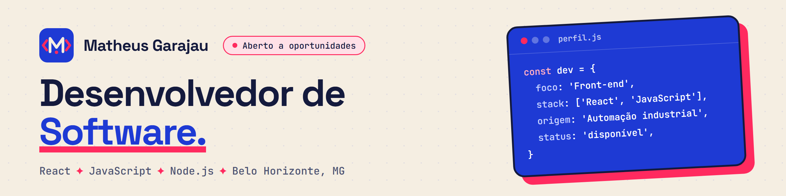

### Sobre mim

Sou desenvolvedor de software e crio aplicações web com JavaScript e React.

Antes da programação, trabalhei por 2 anos como técnico de automação na FUNED, monitorando os sistemas das câmaras frias que armazenam soros e vacinas. Hoje busco minha primeira oportunidade em tecnologia: desenvolvedor júnior ou outra posição de entrada.

### Tecnologias

### Projetos

| Projeto | O que é | Links |
| :--- | :--- | :--- |
| **Portfólio** | Meu portfólio pessoal, feito com React e Vite. | [online](https://mgarajau.github.io/portfolio/) · [código](https://github.com/mgarajau/portfolio) |
| **Site de Arquitetura** | Site institucional com 4 páginas, React Router e projetos carregados de uma API REST. | [online](https://mgarajau.github.io/site-arquitetura-react/) · [código](https://github.com/mgarajau/site-arquitetura-react) |
| **Lista de Tarefas** | Adicionar, concluir e remover tarefas com JavaScript puro, salvas no localStorage. | [online](https://mgarajau.github.io/task-list/) · [código](https://github.com/mgarajau/task-list) |
| **Blog Responsivo** | Página de blog com HTML semântico que se adapta a celular, tablet e desktop. | [online](https://mgarajau.github.io/blog-responsivo/) · [código](https://github.com/mgarajau/blog-responsivo) |

### Trajetória

- **Formação em Desenvolvimento de Software**, Escola DNC (2024 a 2026)
- **Técnico de Automação**, FUNED (abr 2024 a mar 2026)

### Contato

